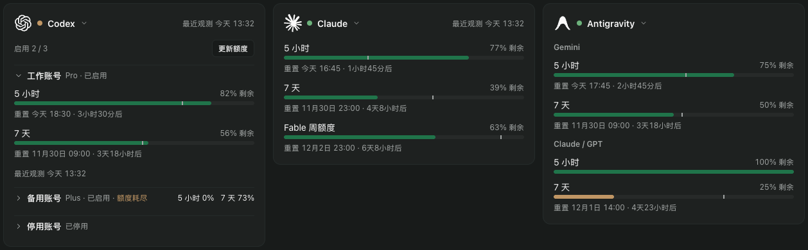

# Paseo Provider Usage

在已有会话的输入框旁可以直接看到常用 Codex 账号和 Claude 的剩余额度。点击 **Codex**、**Claude** 或 **Antigravity** 可查看各窗口的剩余百分比和设备当地的重置时间。侧边栏的 **Provider Usage** 汇总这台主机的所有读数。Codex 和 Claude 的读数也会出现在 Paseo 全局 Usage 中。



## 安装

需要 Paseo 0.17.4 或更高版本。Claude 额度采集需要运行会话的 daemon 使用 Paseo 0.17.5 或更高版本。在客户端为目标主机启用插件，打开 **设置 → 插件 → … → 从来源安装**，粘贴 `https://github.com/Spark0139/paseo-provider-usage.git`。也可以在运行 Agent 的 daemon 主机上使用 CLI 安装。

```sh
paseo plugin install github:Spark0139/paseo-provider-usage
```

安装后，在侧边栏打开 **Provider Usage → 设置** 配置数据源。通过仓库地址安装的插件可用 `paseo plugin update paseo-provider-usage` 更新。

## 接入数据源

- **Codex**。在 **设置 → Codex → 添加 Keeper 实例** 填入名称和 Keeper 地址（如 `https://keeper.example.com/usage`）。开启登录的实例还需填写密码，密码保存在 daemon 上。点击 **测试连接** 后保存。账号优先显示 Keeper 中设置的别名，其次显示账号备注的首行。添加多个实例时可按实例查看启用数和额度。插件已验证 Keeper v2.1.2。[安装 CPA Usage Keeper](https://github.com/Willxup/cpa-usage-keeper/tree/v2.1.2)
- **常用 Codex 账号**。在 **设置 → Codex → 常用账号** 选中 Keeper 里的账号备注，聊天入口就会固定显示这个账号的剩余额度。例如 `Codex 82%` 表示五小时剩余 82%，只有周额度时会写成 `7天 20%`。保留「自动」会优先显示有读数的可用账号。点开浮卡可查看所有账号和窗口。
- **更新 Codex 额度**。活跃账号的普通请求带回额度时，Keeper 会更新缓存。聊天里的 Codex 入口、浮卡和额度总览在前台显示时，每分钟同步已有读数。要立即查询，点击该实例的 **更新额度** 一次，完成后会自动显示结果。需要定期主动查询时，可在 Keeper 的 **巡检 → 齿轮 → 定时刷新** 设置周期。
- **Claude**。在 **设置 → Claude** 选择平时用于聊天的 Claude 启动配置，打开 **采集额度**。等当前回合结束，在原 Chat 的标签页菜单选择 **重新加载 Agent** 一次，或用此配置新建 Chat。正常发消息后，在 **检查接入** 查看采集状态。曾手动添加旧采集前缀的用户，先把启动命令还原一次。[Claude 采集与迁移](docs/claude-collection.md)
- **Antigravity**。先在 Paseo 中配置 Antigravity Provider，再在插件设置中打开 **显示额度**。使用代理时，沿用现有包装命令和环境，保留 `acp` 与 `--disable-telemetry` 参数。卡片按 Paseo 返回的额度组显示各自的剩余比例与重置时间，例如 Gemini 的五小时和每周窗口。[Paseo Antigravity 配置](https://paseo.sh/docs/supported-providers/antigravity)

## 卸载

在 daemon 主机运行 `paseo plugin remove paseo-provider-usage`。插件自己的设置、Keeper 登录密码与额度快照保存在 `$PASEO_HOME/provider-usage/`（默认 `~/.paseo/provider-usage/`）。如需清除，卸载后删除该插件数据目录。

## 许可证

MIT。[许可证](LICENSE) · [第三方归属](THIRD_PARTY_NOTICES.md)
